<p align="center"></p>

# CareCompass

CareCompass는 여러 병원에 흩어진 진료 기록을 한곳에 모아 쉽게 읽고, 필요한 기록만 골라 QR로 의료진에게 보여 주는 서비스입니다.

이 저장소는 CareCompass의 웹 프론트엔드입니다. 환자용 모바일 웹과 의료진용 PC 웹이 함께 들어 있습니다.

> [!NOTE]
> 팀 프로젝트에서 UI 디자인(Figma)과 프론트엔드 개발을 맡았습니다. 백엔드와 인프라는 팀의 별도 저장소에서 관리하며, 이 저장소에는 들어 있지 않습니다.

## 주요 화면

### 환자 앱 `/app/*`

모바일 360px 기준으로 만들었습니다. 넓은 화면에서는 480px 폭으로 가운데에 놓입니다.

| 영역 | 화면 |
|---|---|
| 시작하기 | 로그인, 회원가입 3단계(약관 동의 → 계정 만들기 → 이메일 인증), 가입 완료, 비밀번호 찾기 3단계. 계정 만들기에서 이름, 생년월일, 휴대폰 번호를 받습니다 |
| 홈과 진료 기록 | 진료 기록 목록과 필터, 다음 진료 카드, 진료 일정, 진료 준비(그 진료과 기록과 관련 증상만, 처음엔 아무것도 고르지 않음), AI 쉬운 설명과 원문, 진단·검사·처방 상세 |
| 증상 기록 | 5단계 입력(부위 → 시작한 날 → 위치 → 시간과 빈도 → 아픈 정도), 입력 확인, AI 요약과 수정, 저장 완료, 모아 보기. 시작한 날을 모르면 '잘 모르겠어요'를 고를 수 있습니다 |
| 병원 찾기와 공유 | 지역별 병원 찾기, 병원 정보, 공유할 기록 고르기(다음 진료나 고른 병원의 진료과 기록과 관련 증상만, 처음엔 모두 해제), 30초마다 바뀌는 공유 QR, 공유 내역 |
| 내 정보 | 프로필 수정(이름, 생년월일, 휴대폰 번호), 건강 정보(성별, 키, 몸무게, 앓고 있는 질환, 복용 중인 약, 모두 선택), 비밀번호 변경, 약관과 정책, 로그아웃, 계정 삭제 |

### 의료진 PC `/clinician/*`

1280px 기준으로 만들었습니다.

| 영역 | 화면 |
|---|---|
| 시작하기 | 로그인, 첫 로그인 비밀번호 변경 |
| 기록 받기 | PC 카메라로 QR 읽기, 공유 코드 입력, 오늘 공유받은 환자 목록 |
| 진료 | 공유받은 기록(환자 원문과 AI 요약), 진료 기록 작성과 저장 |

두 앱 모두 목록이 비었을 때, 불러오지 못했을 때, 일부만 불러왔을 때, 로그인이 만료됐을 때의 상태 화면이 있습니다.

## 기술 스택

| 분야 | 사용 |
|---|---|
| 기본 |    |
| 스타일 |  |
| 라우팅 |  |
| 모션 |   |
| 로그인 |   |
| QR | `qrcode.react` QR 그리기, `jsQR` PC 카메라로 읽기 |
| 테스트 |   `fast-check` |
| 코드 검사 |  |

## 시작하기


Node.js 24 LTS 중 24.15 이상이 필요합니다. 잠금 파일에 든 jsdom 31의 요구 버전입니다.

1. 패키지를 설치합니다.

   ```bash
   npm install
   ```

2. `.env.example`을 `.env`로 복사하고 값을 채웁니다. 로그인과 데이터 화면은 CareCompass 백엔드(Cognito, API)가 있어야 동작합니다.

   | 이름 | 설명 |
   |---|---|
   | `VITE_COGNITO_USER_POOL_ID` | Cognito 사용자 풀 ID (예: `us-east-1_xxxx`) |
   | `VITE_COGNITO_CLIENT_ID` | Cognito 앱 클라이언트 ID |
   | `VITE_COGNITO_REGION` | Cognito 리전 (예: `us-east-1`) |
   | `VITE_API_URL` | 백엔드 API 주소 (예: `https://xxxx.execute-api.us-east-1.amazonaws.com`). 끝의 `/v1`은 있어도 없어도 됩니다 |

   `.env`는 커밋하지 않습니다.

3. 개발 서버를 실행합니다.

   ```bash
   npm run dev
   ```

   값이 비어 있거나 사용자 풀 ID와 리전이 맞지 않으면 앱이 시작하자마자 오류를 보여 줍니다.

## 스크립트

| 명령 | 하는 일 |
|---|---|
| `npm run dev` | 개발 서버 실행 |
| `npm run typecheck` | 타입 검사만 실행 (`tsc`) |
| `npm run build` | 타입 검사 후 배포용 빌드 (`dist/`) |
| `npm run preview` | 빌드 결과 미리 보기 |
| `npm run lint` | ESLint 검사 |
| `npm test` | 테스트 실행 (Vitest) |

테스트 파일은 대상 파일 바로 옆에 `*.test.js(x)`나 `*.test.ts(x)` 이름으로 둡니다.

## 폴더 구조

```
src/
  api.ts            API 함수와 응답 타입. fetch와 Cognito 호출은 이 파일에서만
  App.jsx           라우트, 화면 전환 모션, 로그인 확인, 로그인 만료 대화상자
  components/
    ui.tsx          공통 컴포넌트 (버튼, 칩, 탭, 시트, 대화상자, 토스트, 입력칸, 상태 화면, 스켈레톤 …)
    inputs.jsx      날짜·시간 선택, 숫자 스테퍼, 아픈 정도 슬라이더, 여러 줄 입력, 휴대폰 번호·단위(cm, kg) 입력칸
    icons.jsx       평면 아이콘과 3D 아이콘
    RiveIcon.jsx    Rive 3D 아이콘 (파일이 없으면 기본 아이콘으로 표시)
    Followup.jsx    홈의 다음 진료 카드
    RecordRow.jsx   진료 기록 목록의 한 줄
  lib/
    backendMap.js   백엔드 응답을 화면 타입으로 변환, 오류 문구, 지역 코드
    clinicSearch.ts 주변 병원 검색 요청과 결과 검증, 네이버 길찾기 주소 확인
    format.js       날짜 형식, 진료과 이름, 휴대폰 번호 형식
    symptom.js      증상 기록 질문과 화면 문구, 증상별 관련 진료과, 진료과에 맞는 기록 고르기
    schedule.js     지난 일정 판단
    terms.js        약관 본문
    redirect.js     로그인 뒤 돌아갈 주소
    …               길찾기 주소, 최근 찾은 병원, 등장 모션, 화면 꺼짐 방지
  pages/app/        환자 앱 화면
  pages/clinician/  의료진 PC 화면
public/assets/      로고, 평면 아이콘, 3D 아이콘
docs/               README 배너
```

## API 연결

화면은 `src/api.ts`의 함수만 호출합니다. 요청과 응답의 형태는 이 파일의 타입(`CareRecord`, `ShareGrant`, `Followup` …)과 함수별 주석에 있습니다.

| 영역 | 함수 | 요청 |
|---|---|---|
| 내 정보 | `getMe`, `updateMe`, `deleteAccount` | `GET /me`, `PATCH /me`, `POST /me/delete` |
| 진료 기록 | `getRecords`, `getRecord`, `regenerateEasy` | `GET /me/records`, `GET /me/records/{id}`, `POST /me/records/{id}/easy` |
| 진료 일정과 준비 | `getFollowups`, `getSchedule`, `getPrep`, `savePrep` | `GET /me/followups[?include=past]`, `GET`·`PUT /me/followups/{id}/prep` |
| 증상 기록 | `summarizeSymptom`, `createSymptom`, `updateSymptom`, `deleteSymptom` | `POST /me/symptoms/summary`, `POST /me/symptoms`, `PATCH`·`DELETE /me/symptoms/{id}` |
| 병원 | `getClinics`, `getClinic` | `GET /clinics`, `GET /clinics/{id}` |
| 주변 병원 검색 | `searchNearbyClinics` | `POST /clinic-search/jobs` 후 `GET /clinic-search/jobs/{jobId}`로 결과를 기다림 |
| 공유 | `getShareGrants`, `createShareGrant`, `getShareGrant`, `rotateShareGrant`, `revokeShareGrant`, `previewShareGrant`, `redeemShareGrant` | `/share-grants` 아래 |
| 의료진 | `getClinicianMe`, `getReceivedShares`, `createVisit` | `GET /clinician/me`, `GET /clinician/shares?date=today`, `POST /clinician/visits` |

### 백엔드와 연결

- 백엔드 경로는 모두 `/v1` 아래에 있습니다.
- 백엔드 응답은 `src/lib/backendMap.js`에서 화면 타입으로 바꿉니다. 백엔드가 주지 않는 값(쉬운 설명, 병원 전화번호, 일정의 병원 이름 등)은 화면에서 숨기거나 기본값으로 채웁니다.
- `npm run dev`로 실행하면 Vite 프록시가 `/v1` 요청을 `VITE_API_URL`로 넘겨 줍니다. 그래서 백엔드에 CORS를 설정하지 않아도 로컬에서 바로 연결됩니다.
- 백엔드에 아직 없는 기능(공유, 의료진 화면, 증상 기록 저장, 진료 준비)을 열면 "아직 준비 중인 기능입니다" 안내가 나옵니다.
- 기록 공유와 진료 준비는 다음 진료의 진료과로 기록을 거릅니다. 진료과는 일정을 만든 기록이나 같은 병원의 진료 기록에서 찾고, 증상 기록은 증상 종류별로 정한 관련 진료과(`symptom.js`의 `symptomSpecialties`)로 판단합니다. 백엔드 일정에 병원 이름과 진료과가 아직 없어서, 실서버에서는 거르지 않고 전체를 보여 줍니다.

### 로그인과 계정

- 로그인, 회원가입, 비밀번호 찾기는 Amplify로 Cognito를 직접 호출합니다. Cognito 오류는 `api.ts`의 `AUTH_MESSAGES`에서 한국어 문구로 바꿉니다.
- 모든 요청에 Cognito Access 토큰을 `Authorization: Bearer …`로 붙입니다. 화면에 쓰는 이메일과 역할(`cognito:groups`의 `patient`, `clinician`)은 ID 토큰에서 읽습니다.
- 계정은 관리자가 만들고, 의료진은 첫 로그인 때 비밀번호를 바꿉니다. 회원가입 화면을 쓰려면 Cognito 사용자 풀에서 자체 가입을 켜야 합니다.
- 가입할 때 동의한 약관 목록은 Cognito 사용자 속성 `custom:consents`로, 휴대폰 번호는 표준 속성 `phone_number`(`+8210…` 형식)로 보냅니다.
- 프로필 수정과 건강 정보는 `PATCH /me`로 전체 값을 보내고 `GET /me`에서 읽습니다. 이름, 생년월일, 이메일, 휴대폰 번호는 ID 토큰에서도 읽습니다.
- 로그인하지 않고 로그인이 필요한 화면에 들어오면 로그인 화면(`?next=`)으로 보냈다가, 로그인한 뒤 원래 화면으로 돌려보냅니다. 돌아갈 주소는 같은 역할의 앱 안 주소만 받습니다(`src/lib/redirect.js`).

### 오류 처리

- 요청이 실패하면 `ApiError { status, code, message }`를 던집니다. 화면은 `message`를 그대로 보여 주고, 네트워크 오류면 `code`가 `'NETWORK'`입니다.
- 401 응답을 받으면 로그아웃하고, 보던 화면 위에 "다시 로그인해 주세요" 대화상자를 띄웁니다.

### 그 밖의 동작

- 공유 QR은 30초마다 `rotateShareGrant`로 새 토큰을 받아 다시 그립니다.
- AI 요약과 쉬운 설명은 백엔드 API가 만듭니다. 프론트엔드에는 AI API 키를 넣지 않습니다.

## 모션

| 종류 | 동작 |
|---|---|
| 화면 전환 | 앞으로 가면 새 화면이 오른쪽에서 들어오고, 뒤로 가면 왼쪽에서 돌아옵니다. 움직임은 휴대폰 화면(480px) 안에서만 일어납니다. 하단 탭과 화면 안 탭을 바꿀 때는 밀려나지 않고 겹쳐서 바뀝니다(`src/App.jsx`). |
| 콘텐츠 등장 | 블록이 위에서부터 차례로 떠오릅니다. 로딩이 끝나 내용이 바뀌면 새로 들어온 블록만 같은 방식으로 나타납니다. 간격과 속도는 `src/lib/reveal.js`의 `REVEAL`에서 한 번에 조절합니다. |
| 3D 아이콘 | 처음 나타날 때 살짝 튀어 오르고, 아이콘마다 움직임이 다릅니다. 자물쇠는 흔들리고, 종은 울리고, 하트는 두근거립니다. `public/assets/rive/<이름>.riv` 파일을 넣으면 그 아이콘은 Rive 애니메이션으로 바뀝니다(`src/components/icons.jsx`, `RiveIcon.jsx`). |
| 로딩 | 내용이 들어올 자리에는 반짝이는 스켈레톤이, 버튼에는 천천히 커졌다 작아지는 스피너가 보입니다. |
| 그 밖 | 아래에서 올라오는 시트, 단계 진행 막대, 아픈 정도 숫자, 저장 완료 체크 표시, QR이 바뀔 때 다시 그려지는 효과, 탭에서 고른 칸으로 미끄러지는 선택 바탕(`Segmented`) |
| 움직임 줄이기 | 기기에서 "움직임 줄이기"를 켜면 화면 전환과 등장 모션의 이동이 빠지고, 스켈레톤 반짝임과 QR 효과도 멈춥니다. |

## 배포

`npm run build`로 만든 `dist/`는 정적 파일입니다. S3 + CloudFront, Amplify Hosting, Netlify, Vercel 같은 정적 호스팅에 그대로 올리면 됩니다.

- **API 요청 전달**: 배포한 화면도 `/v1`로 요청합니다. Amplify Hosting에서는 재작성 및 리디렉션에 `/v1/<*>` → `<백엔드 주소>/v1/<*>` 규칙(유형 `200 (Rewrite)`)을 SPA 규칙보다 위에 추가하면 CORS 없이 연결됩니다.
- **SPA 설정**: `/app/home`, `/clinician/patients` 같은 주소는 브라우저에서 라우팅합니다. 없는 경로에는 모두 `index.html`을 돌려주도록 호스팅을 설정해야 새로고침하거나 주소로 바로 들어와도 화면이 뜹니다.
- **HTTPS**: 의료진의 QR 읽기(PC 카메라)와 공유 QR 화면의 화면 꺼짐 방지(Wake Lock)는 HTTPS에서만 동작합니다. `localhost`에서는 HTTP로도 동작합니다.
- **환경 변수**: `.env` 중 `VITE_`로 시작하는 값만 빌드할 때 번들에 들어갑니다. 번들에 들어간 값은 누구나 볼 수 있으니, 공개돼도 괜찮은 Cognito ID와 API 주소만 넣고 비밀 값은 넣지 않습니다.
